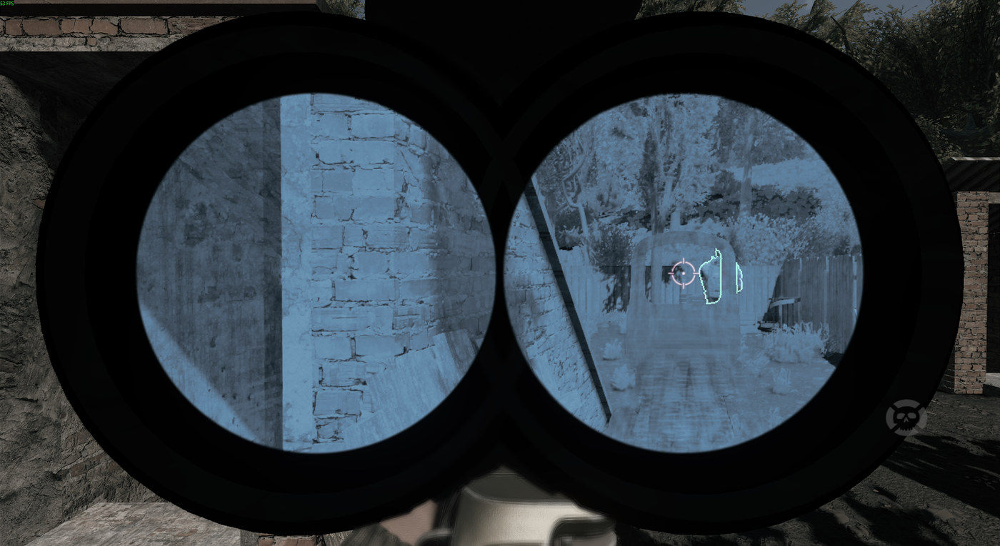
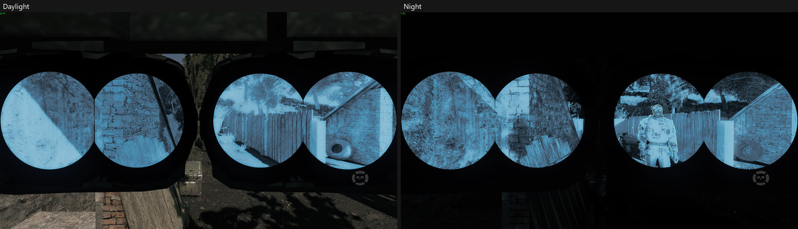

# Unholy's nvg mod

Eleven wearable night-vision devices, from analog and digital PVS-69 monoculars and binoculars to a Gen 3 panoramic quad. The devices include stowing animations, helmet fits, eye glow, and reflex-sight aiming.

*Gen 3 binoculars and a right-tube reflex sight in Romeo.*

*GPNVG-18 in daylight and at night.*

*Digital monochrome binoculars in daylight.*

*Third-person fits and stow poses.*

*Eyepiece glow in third person. The comparison uses the same brightness adjustment for all six crops.*

This is a fan-made S.T.A.L.K.E.R. mod. [GSC Game World fan content guidelines](https://www.gsc-game.com/guidelines/)
