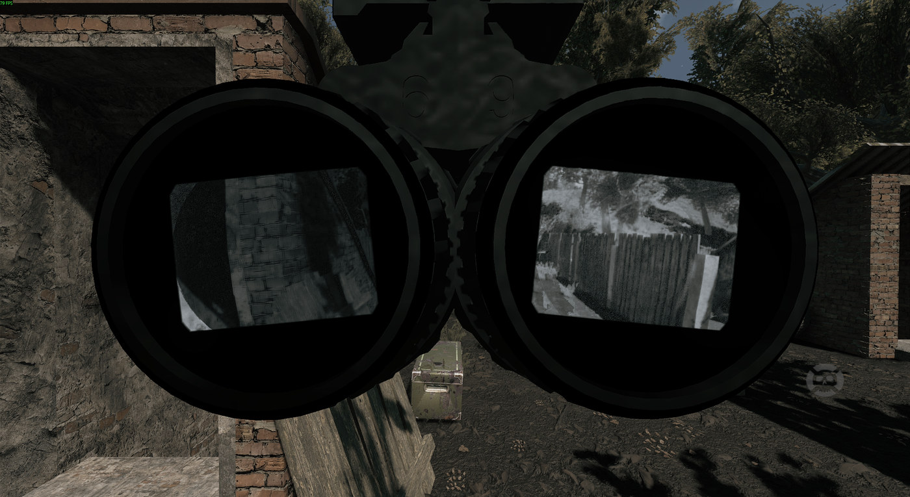
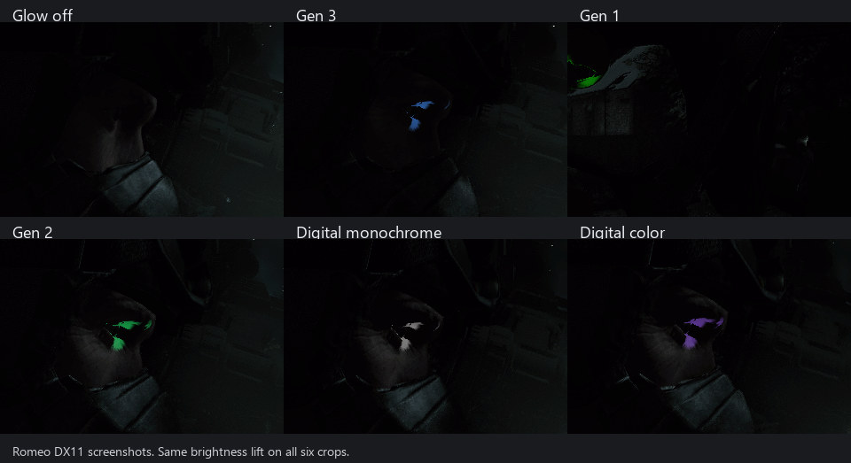

# Unholy's nvg mod

Eleven wearable night-vision devices for S.T.A.L.K.E.R. in one add-on. It includes PVS-69 ALPHA analog and digital monoculars and binoculars, plus the Gen 3 GPNVG-18 quad. Animated stowing, helmet meshes, eye glow, aiming, loot and trader integration are part of the same mod.

*Gen 3 binoculars and a right-tube reflex sight in Romeo.*

## What’s included

- Analog Gen 1, Gen 2 and Gen 3 have a 40° view and independent gain per tube. Gen 3 binoculars add thermal outlines on the right tube. The quad adds outlines on its two center tubes.
- Digital monochrome and color use a 48° view, 800×600 sampling, 4:3 displays and camera-motion blur. The color profile shifts from violet in brighter light to blue as light falls.
- Binoculars fold out of the way. Monoculars use their flip-up mount. Equipped models appear in local third person and tint the skin around the eyes on supported faces.
- Reflex sights align to the right tube. Analog near-focus blur fades out within roughly three feet. NPC equipment rolls use configurable ranks. Trader stock unlocks Gen 1 and digital at tier 1 and Gen 2 at tier 2. Gen 3 stays outside trading.

## Compatibility

| Game | Status | Requirements |
| --- | --- | --- |
| Romeo | Captured in game | The ROMEO - 2026-11-09-001 profile with xrRazom DX11, Shader Bus 7, Screen Space Shaders, matching 3D Shader Scopes and the renderer changes generated by the kit. |
| GAMMA | Port pending | GAMMA’s 3DSS can supply the reflex shader donor. The full stack needs renderer, trade and loot validation. |
| Standalone Anomaly | Port pending | A modern Monolith DX11 engine exposes underlying APIs. The full stack still needs a standalone renderer and gameplay validation. |

Romeo’s digital scene feed is live. The grain updates at 50 Hz. A 50 ms scene delay requires timestamped history textures from the engine. The independent headgear viewport is also pending. [Engine and feature status](COMPATIBILITY.md)

## Installation and availability

Download the Romeo build kit and the noncommercial model assets from [Releases](https://github.com/noahcabral/unholys-nvg-mod/releases). The builder combines the 11 devices with the matching renderer changes using files from your Romeo installation. It produces one MO2 install ZIP. [Build and install](BUILD.md) · [Asset credits](ATTRIBUTION.md)

## In-game gallery

*GPNVG-18 in daylight and at night.*

*Digital monochrome binoculars in daylight.*

*Third-person fits and stow poses.*

*Eyepiece glow in third person. The comparison uses the same brightness adjustment for all six crops.*

This is a fan-made S.T.A.L.K.E.R. mod. [GSC Game World fan content guidelines](https://www.gsc-game.com/guidelines/)
