# Unholy's nvg mod

Eleven wearable night-vision devices, from analog and digital PVS-69 monoculars and binoculars to a Gen 3 panoramic quad. The devices include stowing animations, helmet fits, eye glow, and reflex-sight aiming.

*Gen 3 binoculars and a right-tube reflex sight in Romeo.*

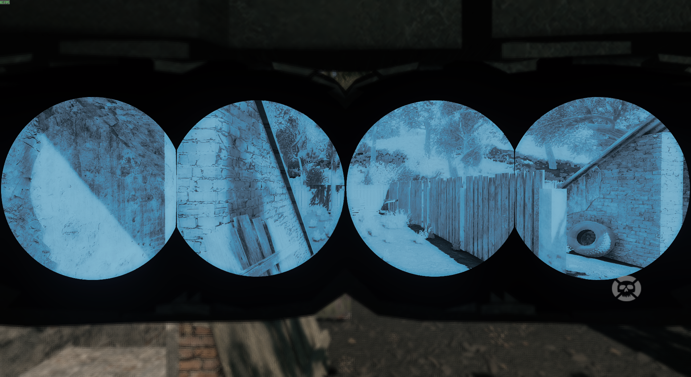

*GPNVG-18 with the narrow center bezel.*

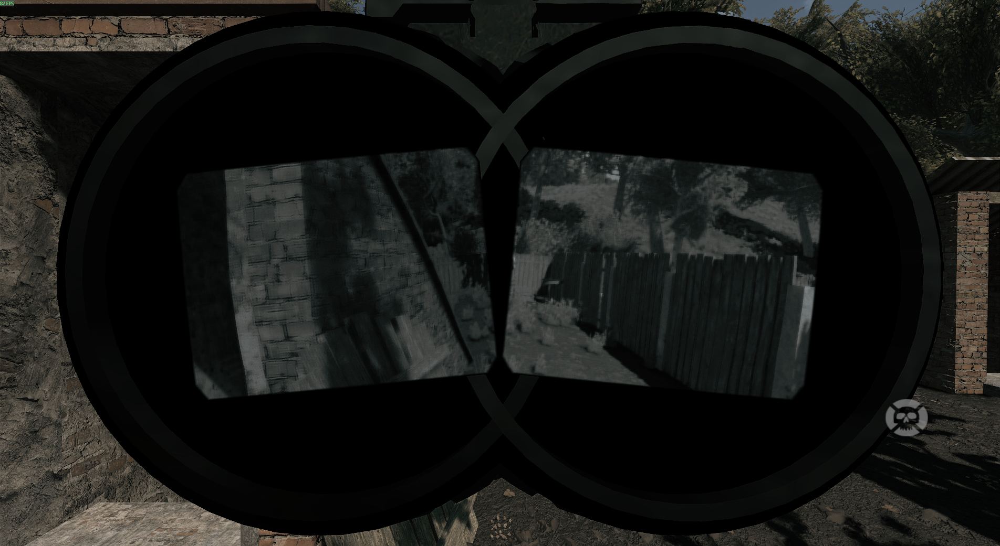

*Digital binoculars with the larger 4:3 displays.*

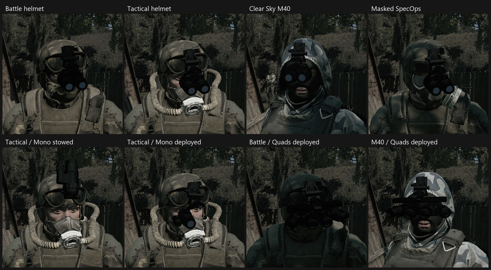

*Third-person fits and stow poses.*

*Eyepiece glow in third person. The comparison uses the same brightness adjustment for all six crops.*

## At night

All eleven devices in the same Cordon alley at 22:00 in Romeo.

| Sensor | Monocular | Binocular |
| --- | --- | --- |
| Gen 1 | 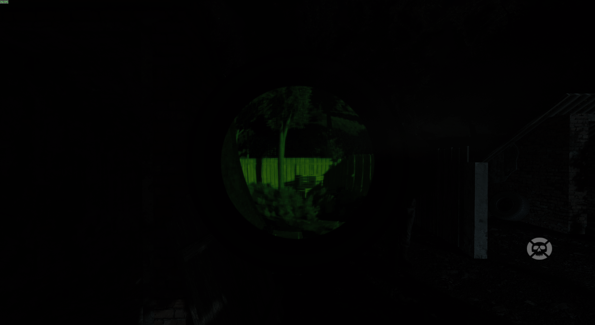 | 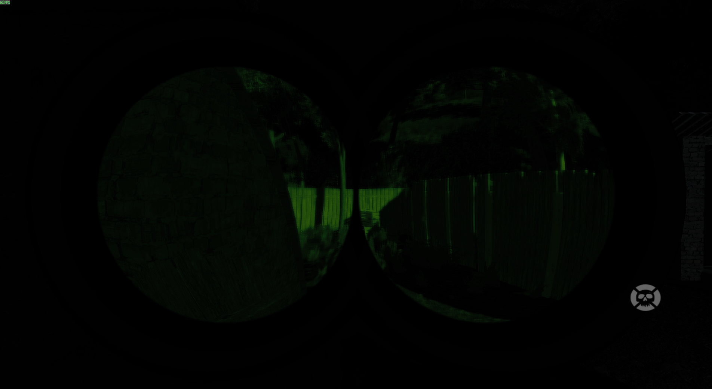 |
| Gen 2 | 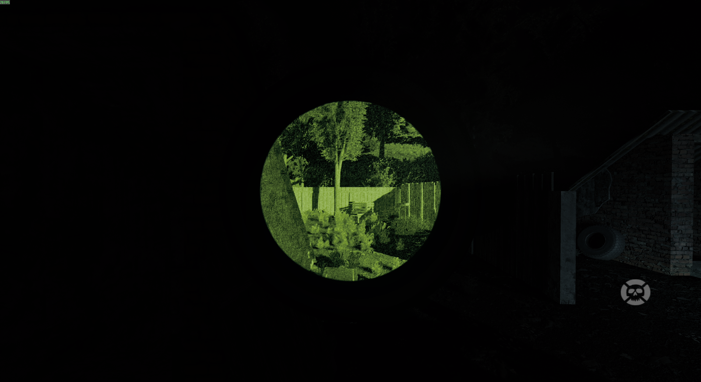 | 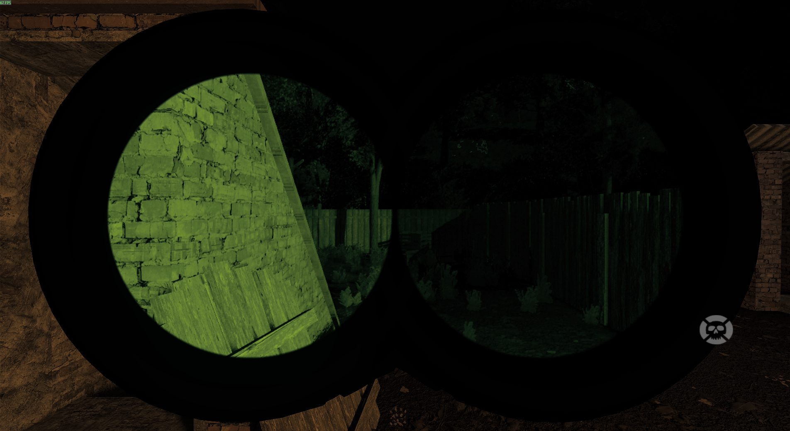 |
| Gen 3 | 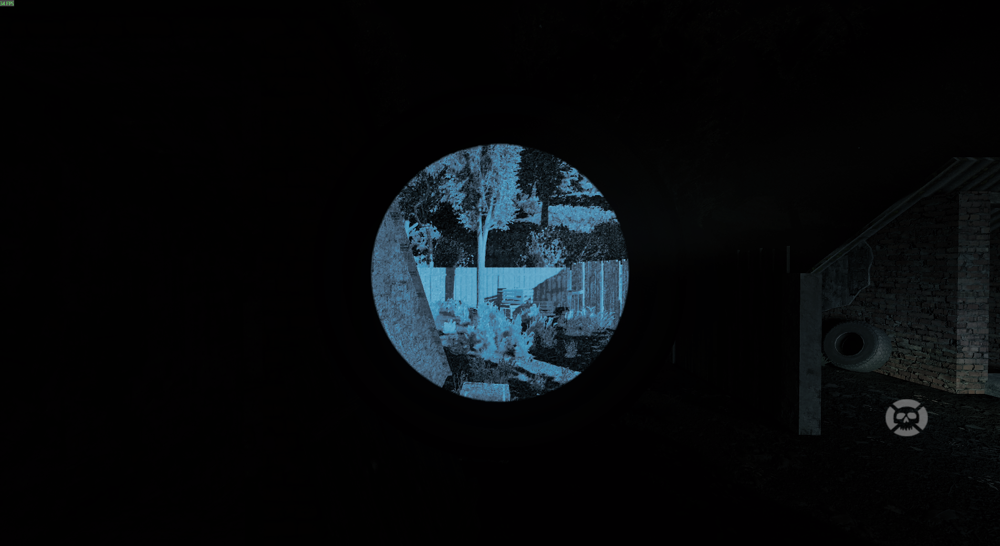 | 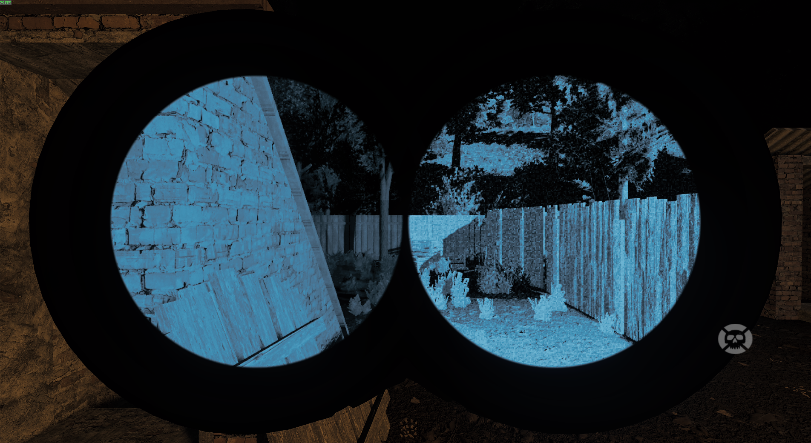 |
| Digital monochrome | 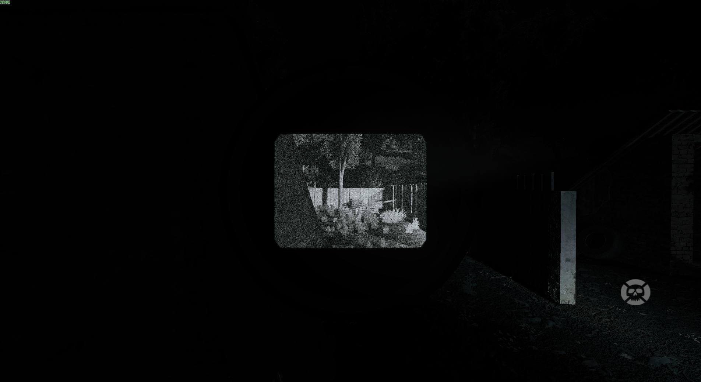 | 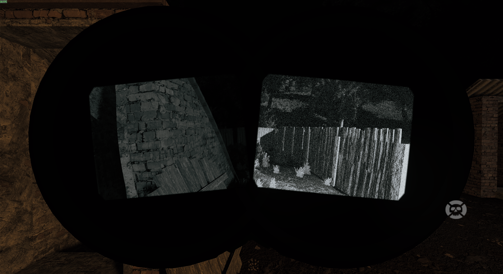 |
| Digital color | 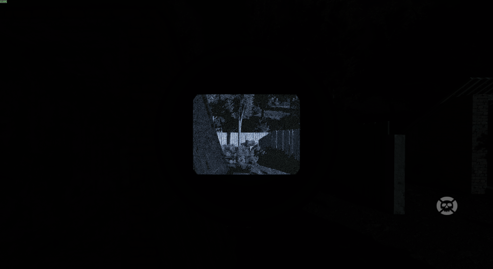 | 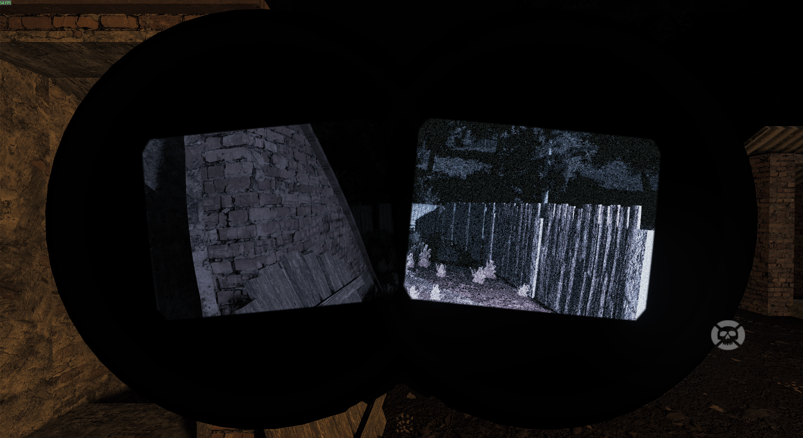 |

### Gen 3 quad

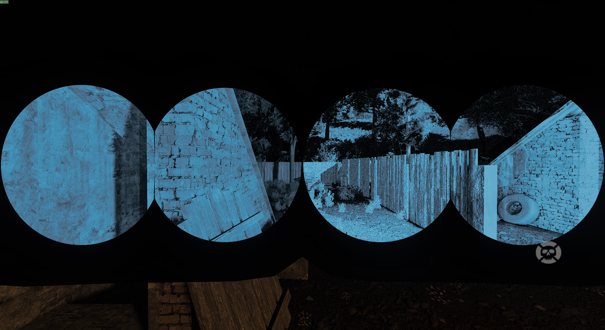

This is a fan-made S.T.A.L.K.E.R. mod. [GSC Game World fan content guidelines](https://www.gsc-game.com/guidelines/)
